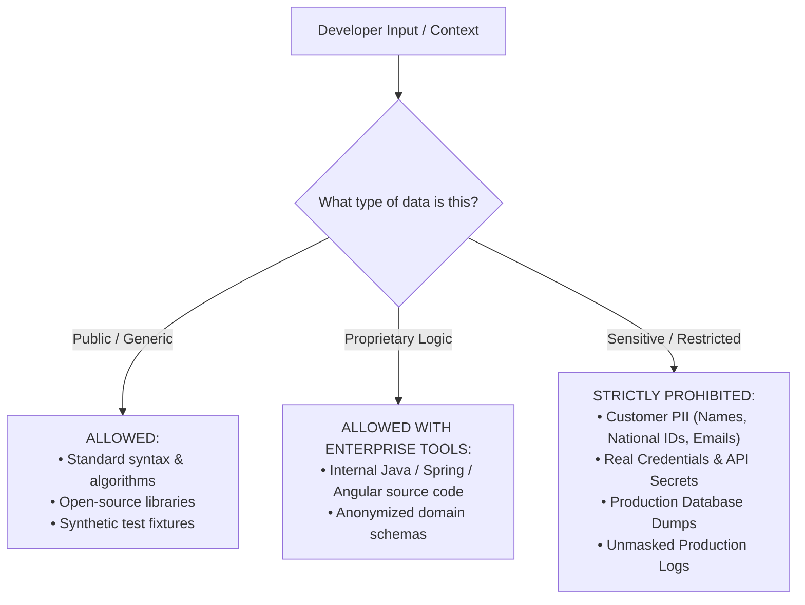
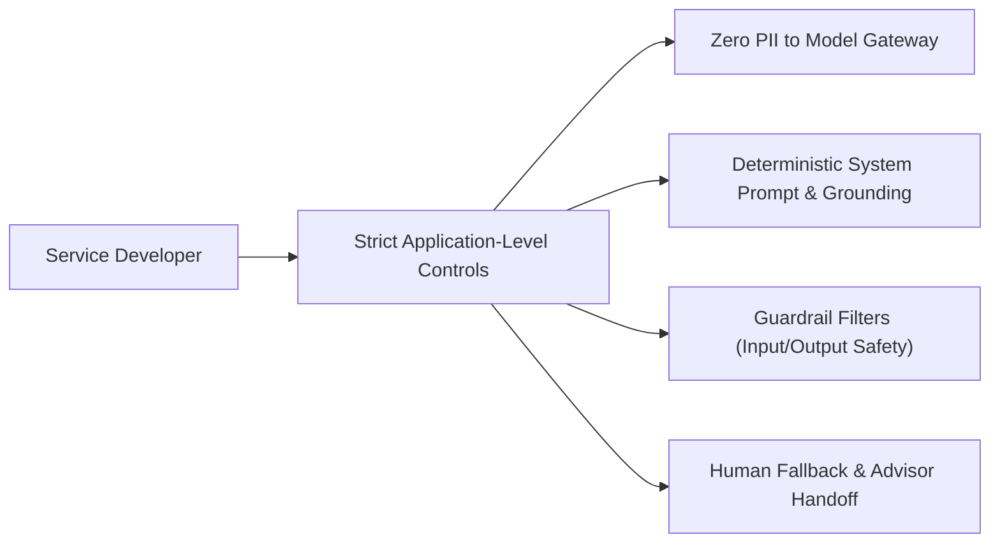

# Engineering Guidelines for the Responsible Use of AI in Software Engineering

## 1. Purpose and Scope

These guidelines govern the safe, compliant, and responsible use of Artificial Intelligence (AI) tools—such as AI coding assistants, code generation tools, test generators, and documentation copilots—by **all internal developers, QA engineers, and third-party vendors (Nimbus Digital)** within the Direct Digital Channel cell.

AI tools offer significant velocity enhancements, but they introduce serious risks regarding data privacy, security vulnerabilities, copyright infringement, and intellectual property leakage. Every team member is bound by this policy.

---

## 2. Approved Tools and Permitted Tool Types

| Category | Approved Tools | Usage Scope | Prohibited Tools / Practices |
|---|---|---|---|
| **Enterprise Coding Assistants** | • **GitHub Copilot Business / Enterprise**<br/>• **Google Gemini Code Assist (Enterprise)** | IDE code completion, unit test scaffolding, boilerplate generation, regex crafting. | Free/public AI tools without enterprise data confidentiality agreements (e.g., personal ChatGPT accounts, public web copilots). |
| **Documentation & Summarization** | • Enterprise Azure OpenAI (Meridian Tenant)<br/>• Enterprise Gemini Workspace | Drafting API documentation, summarizing logs/traces, drafting RFCs. | Feeding customer PII, unmasked production logs, or corporate secrets into web-based AI tools. |
| **Code Review & Static Analysis** | • SonarQube AI Reviewer<br/>• GitHub Advanced Security Copilot | Automated security triage, detecting vulnerability explanations. | Blindly auto-merging PRs without thorough human code review. |

---

## 3. Data Classification: What May and May Not Be Shared with AI

Meridian Mutual enforces a strict data classification boundary. Code assistants must be configured with **Data Retention Disabled** (zero storage for model training):



### Prohibited Data List:
- **Zero Real Customer PII:** Never paste customer names, national IDs (`RFC`, `CURP`, `RUT`, `Cédula`), phone numbers, emails, or policy numbers into an AI prompt.
- **Zero Secrets & Credentials:** Never share API keys, OAuth client secrets, database passwords, private keys, or certificates.
- **Zero Proprietary Financial / Actuarial Algorithms:** Do not input raw, unreleased actuarial loss models or proprietary risk calculations.

---

## 4. Review, Validation, and Disclosure Requirements

### 4.1 Accountability
**The human developer who commits code is 100% accountable for every line of code.** An excuse of *"the AI generated it"* is an immediate breach of professional standards and will not be accepted.

### 4.2 Mandatory Validation Steps Before Merge
1. **Compilability and Testing:** Every AI-generated function or test must compile and pass automated unit/integration tests with real assertions. AI tools frequently hallucinate test assertions (e.g., mocking the class under test as seen in PR-388).
2. **Security & Vulnerability Review:** Every AI suggestion must be manually scrutinized for:
   - Insecure deserialization and injection vulnerabilities (SQLi, XSS, Log Injection).
   - Inefficient resource allocation (unbounded loops, missing timeouts, improper HTTP clients).
   - Hallucinated or deprecated third-party libraries (dependency hallucination / typosquatting).
3. **Intellectual Property & Licensing Check:** Developers must enable Copilot's *"Block suggestions matching public code"* filter to prevent verbatim ingestion of GPL or copyrighted external source code.

### 4.3 Mandatory Disclosure in Pull Requests
Every pull request submitted by internal developers or Nimbus Digital must declare whether AI assistance was utilized using the standard PR template:

```markdown
### AI Usage Disclosure
- [x] AI tools were used in this change.
- **Tool(s):** Gemini Code Assist / GitHub Copilot
- **Scope of Use:** Generated initial unit test scaffolding and OpenAPI schema boilerplate.
- **Validation Performed:** Verified all test assertions against real business edge cases; checked SonarQube for security vulnerabilities.
```

---

## 5. Additional Controls When the Cell Builds Features that Call an LLM

When engineering services or user journeys that directly invoke LLMs (such as the **BR-02 GenAI Assistant** analyzed in `FEASIBILITY_GENAI.md`):



1. **Zero Customer PII Sent to LLMs:** The application layer must scrub all personal identifiers before passing prompts to Azure OpenAI.
2. **Strict Grounding (RAG Only):** Dynamic generative hallucination is forbidden. Responses must be retrieved strictly from approved knowledge bases (product PDF wordings).
3. **No Financial / Legal Advice:** Guardrail filters must block any query attempting to elicit an insurance purchase recommendation (*"Which policy should I buy?"*).
4. **Latency & Timeout Guards:** LLM calls must have strict client-side timeouts (max 4.0 s) with non-blocking graceful fallbacks in the UI.

---

## 6. Rollout, Enforcement, and Measurement

### 6.1 Vendor Enforcement (Nimbus Digital)
Compliance with these AI guidelines is incorporated as a mandatory appendix to **Nimbus Digital's contract renewal on 31 January 2027**. Nimbus developers must sign and adhere to the same enterprise standards.

### 6.2 Automated Auditing and Compliance Metrics
1. **Automated Secret Scanning (Gitleaks):** Blocks any commit attempting to share credentials with external systems.
2. **PR Compliance Audits:** Meridian Technical Lead performs weekly random sampling of AI-disclosed PRs to verify test assertion validity.
3. **Metrics Tracked:**
   - % of PRs declaring AI usage.
   - Change failure rate (CFR) of AI-assisted vs non-AI-assisted changes.
   - SonarQube vulnerability frequency on AI-assisted modules.
