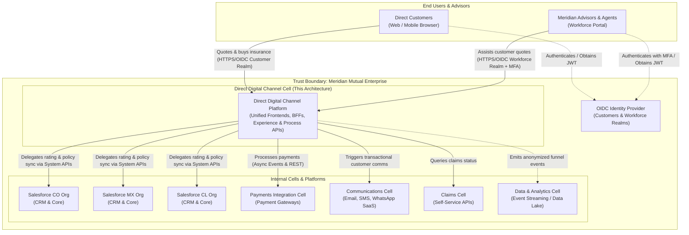
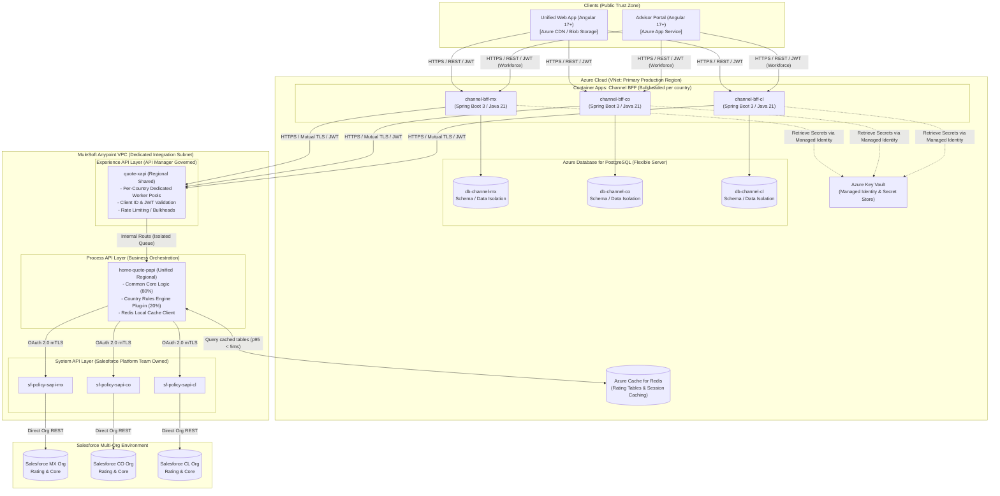
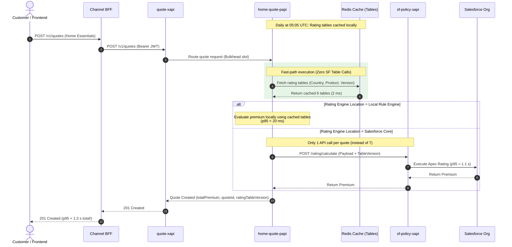
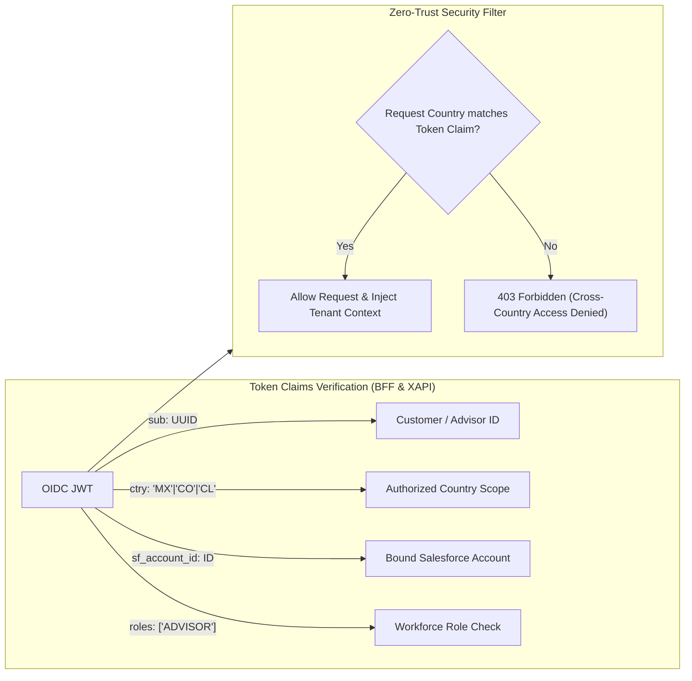
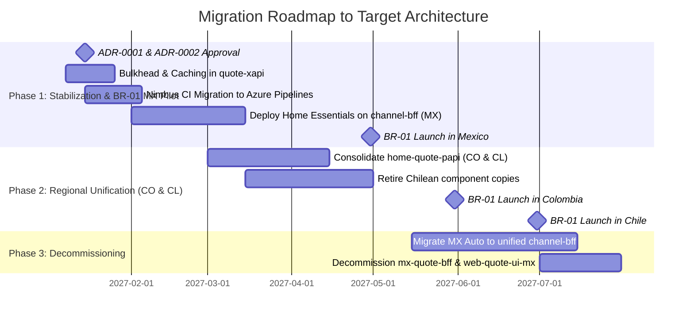

# Target Architecture — Direct Digital Channel

## 1. Executive Summary and Architecture Vision

The target architecture for Meridian Mutual's Direct Digital Channel unifies the quote-and-buy and self-service journeys across **Mexico (MX), Colombia (CO), and Chile (CL)** into a resilient, reusable, multi-tenant digital platform. It directly fulfills business request **BR-01 (Home Essentials)** and establishes the foundation to eliminate legacy country forks, preventing catastrophic cascading outages like **INC-0907**.

The architecture adheres strictly to:
- **C1 (Availability):** 99.5% monthly availability per country with strict bulkhead tenant isolation. Overload or failure in one country (e.g., month-end in MX) cannot degrade other countries.
- **C2 (Performance):** End-to-end quote response time under **2.5 s at p95** during peak load (up to 3× in MX, 2× in CO/CL).
- **C3 (Reuse & Regionality):** Core business logic, journeys, and infrastructure built once; country variations injected via configuration and strategy plug-ins without code branches or repository forks.
- **C4 (API-Led Integration):** Strict three-tier API-led connectivity (Experience, Process, System APIs) through MuleSoft Anypoint and API Manager. Direct access to Salesforce from BFFs or Process APIs is strictly prohibited.
- **C5 (Security & Data Protection):** Zero trust boundaries, OIDC JWT-based identity propagation, strict per-country data segregation, automated secret management via Azure Key Vault, and zero PII in logs or telemetry.
- **C6 (Salesforce Quota Compliance):** Comprehensive caching of rating tables, asynchronous issuance, and strict request rate limits to guarantee operation within daily API allocations and under the 40 req/s platform limit.

---

## 2. C4 Architecture Models

### 2.1 C4 Level 1 — System Context Diagram

The System Context diagram illustrates Meridian Mutual's Direct Digital Channel ecosystem, user personas, external dependencies, and trust boundaries.

---

### 2.2 C4 Level 2 — Container Diagram

The Container diagram details the internal runtimes, data stores, API layers, network boundaries, and resilience bulkheads.

---

## 3. Capability Allocation: Regional vs. Country-Specific (C3)

To avoid code forks and divergence while supporting local regulatory and fiscal nuances, capabilities are allocated strictly using the **Core Engine + Country Strategy Configuration** pattern:

| Capability | Scope | Implementation Mechanism | Justification |
|---|:---:|---|---|
| **Design System & UI Components** | Regional | Shared Angular Component Library (`@meridian/ui-kit`). | Single brand identity, WCAG 2.1 AA accessibility, unified UX. |
| **Quote-and-Buy Web Application** | Regional | Unified Angular SPA deployed to Azure CDN. Country determined at bootstrap via runtime config or path (`/mx/`, `/co/`, `/cl/`). | Eliminates 3 diverged frontend codebases (`web-quote-ui`, `web-quote-ui-mx`, Chile copies). |
| **Form Fields & Validation Rules** | Country-Config | Metadata-driven form schemas served by BFF. Regex for National IDs (RFC/CURP in MX, Cédula in CO, RUT in CL) loaded via JSON schema. | Zero UI code changes when country document validation rules change. |
| **Channel BFF (`channel-bff`)** | Regional Engine | Single Java 21 / Spring Boot 3 codebase. Configured via Spring Profiles (`application-mx.yml`, etc.) and deployed in country-isolated containers. | Eliminates duplicate maintenance of `mx-quote-bff` while maintaining runtime isolation. |
| **Session & Draft Persistence** | Country-Specific | Dedicated Azure PostgreSQL database instances or isolated schemas per country (`db-channel-mx`, `co`, `cl`) with 30-day TTL. | Complies with C5 and Legal requirements regarding physical/logical isolation of citizen PII. |
| **Quote Experience API (`quote-xapi`)** | Regional Gateway | MuleSoft API Manager proxy enforcing OIDC token validation, rate-limiting, and tenant routing. | Single entry point for all channels (customer, advisor, partners) with centralized governance. |
| **Home Essentials Process API** | Regional Engine | Single `home-quote-papi` MuleSoft application. 80% shared business flow with pluggable Country Rules Modules (taxes, mandatory coverages, surcharges). | Fulfills BR-01 sponsor demand: *"Build it once and make the next product cheaper"*. |
| **Rating Tables & Surcharges** | Regional Cache / Local Data | Daily ingested tables cached in Redis, keyed by `table_version:country:product`. | Ensures microsecond retrieval, shields Salesforce from query volume, guarantees C2 (<2.5s p95). |
| **System APIs (`sf-policy-sapi`)** | Country-Specific | Maintained by Salesforce Platform team. One instance per Salesforce org (`-mx`, `-co`, `-cl`). | Encapsulates org-specific data models, custom objects, and API credentials per country org. |

---

## 4. Integration with Salesforce, Meeting C2 and C6

### 4.1 The Challenge
Salesforce orgs present three major constraints:
1. **Unplanned Unavailability:** Each org is available ≈ 97% of the time (outage windows of 5 to 90 min).
2. **Strict Concurrency Limits:** Maximum **40 req/s** per org before latency spikes.
3. **Daily API Allocations (C6):** Rolling 24-hour limit for Direct Digital Channel (MX: 250k, CO: 300k, CL: 150k).
4. **Target Quote Latency (C2):** Return quote to customer in **< 2.5 s at p95** even during 3× peak volume.

### 4.2 Architecture Solution

### 4.3 Why this guarantees C2 and C6:
1. **Elimination of Table Queries:** Reading 6 rating tables per quote directly from Salesforce (as Nimbus attempted in INC-0907) consumes 85% of API allocations in hours. By caching the 6 rating tables daily at 05:00 UTC (as permitted by the 24h business rule in `SALESFORCE_CONSTRAINTS.md`), Salesforce queries per quote drop from **7 to 1** (or 0 if rating engine runs in Process API).
2. **Quota Math:** 
   - Normal MX volume: 15,000 quotes/month ≈ 500 quotes/day. 
   - Peak month-end (3×): ≈ 1,500 - 3,000 quotes/day.
   - At 1 call/quote = 3,000 calls/day. This represents **1.2%** of the 250,000 daily budget! It leaves 98.8% of the budget available for policy issuances, CRM updates, and other cell integrations.
3. **Protecting the 40 req/s Limit:** MuleSoft API Manager enforces a strict Rate Limiting / Spike Control policy of **30 req/s** per country on `sf-policy-sapi`. Any bursting above this is queued gracefully in the Process API layer with exponential backoff, never overwhelming Salesforce.

---

## 5. Containment of Overload and Cross-Country Blast Radius (C1)

Incident **INC-0907** proved that sharing thread pools, queues, and connections across countries causes total systemic failure when one country experiences a traffic surge.

### 5.1 Bulkhead Implementation Pattern
To guarantee **C1 (99.5% availability per country without cross-country degradation)**:

1. **Dedicated Worker / Thread Pools in `quote-xapi`:**
   - Instead of a single shared pool of 64 in-flight requests and 100 queue depth, `quote-xapi` divides resources into dedicated tenant pools:
     - **MX Pool:** Max 32 in-flight, max 50 queued.
     - **CO Pool:** Max 32 in-flight, max 50 queued.
     - **CL Pool:** Max 24 in-flight, max 35 queued.
     - **System Reserved Pool:** 16 slots for health checks and advisor operations.
   - If Mexico exhausts its pool and queue, incoming Mexican requests receive `429 Too Many Requests` or `503 Service Unavailable` immediately at the API Gateway. **Colombia and Chile threads remain 100% untouched.**

2. **Aggressive Outbound Timeouts and Circuit Breakers:**
   - Outbound timeout from `quote-xapi` to any Process API is reduced from **30 seconds to 3.5 seconds**.
   - Resilience4j circuit breaker configured on each country route:
     - Failure rate threshold: 50% over a sliding window of 20 calls.
     - Slow call threshold: 2,500 ms.
     - Open state duration: 15 seconds before entering half-open.
   - Fast fallback: When a country's circuit breaker opens, `quote-xapi` returns a standardized `ProblemDetails` error with a `Retry-After` header immediately without tying up worker threads.

3. **Isolated BFF Deployments:**
   - BFFs run in Azure Container Apps with separate replica scaling rules per country (`channel-bff-mx`, `channel-bff-co`, `channel-bff-cl`), eliminating memory/CPU competition.

---

## 6. Identity, Security, and Data Protection (C5)

### 6.1 Token Propagation and Tenant Isolation
Meridian utilizes an OIDC Identity Provider with two realms: **Customers** and **Workforce**.

- **Establishing Customer Identity & Country:**
  - The client submits `Authorization: Bearer <JWT>`. 
  - The BFF and `quote-xapi` validate the JWT signature against cached JWKS keys (with background asynchronous refresh on unknown `kid` to prevent rotation blips).
  - The country context is extracted exclusively from the validated claim `ctry` (for customers) or verified against the `countries` array claim (for advisors). **HTTP headers such as `X-Country` or `X-Customer-Id` are untrusted and rejected if they contradict the token.**
  - Cross-tenant prevention: If a customer with a Colombian token attempts to query a Mexican quote ID, the service immediately throws `403 Forbidden`.

- **Preventing PII in Telemetry:**
  - Logback / Log4j2 masking filters are applied across all Java and MuleSoft applications.
  - Regex patterns mask national IDs (`CURP`, `RFC`, `RUT`, `Cédula`), emails, phone numbers, and street addresses, replacing them with `[MASKED_PII]`.
  - Application Insights telemetry initializers strip query parameters and sanitise JSON request/response bodies before exporting metrics.

- **Secrets Management:**
  - Zero plain-text credentials in Git or configuration files.
  - Azure Key Vault stores all secrets (database passwords, OAuth client secrets, encryption keys).
  - Services access Key Vault via **Azure Managed Identities** (`DefaultAzureCredential`).

---

## 7. Migration & Transition Strategy (Avoiding Big-Bang)

To de-risk the evolution from the legacy state (Nimbus MX fork, Chilean copy) to the target state, we execute a phased strangler-fig migration across Q1 and Q2 2027:

### Transition Steps:
1. **Step 1 (Immediate - Q1 W1-W3):** Fix `quote-xapi` by deploying tenant bulkheads and Redis rating table cache. Route MX through `sf-policy-sapi-mx`.
2. **Step 2 (BR-01 Pilot):** Implement Home Essentials as the first journey on the unified `channel-bff` and `home-quote-papi`. Mexico launches first (April 30, 2027) without touching existing Auto journeys.
3. **Step 3 (Replication):** Roll out Home Essentials to Colombia (May 31) and Chile (June 30) simply by enabling country configuration profiles and validating local tax/document rules.
4. **Step 4 (Strangler Completion):** Incrementally migrate legacy Mexican auto journeys from `mx-quote-bff` to `channel-bff`. Decommission `mx-quote-bff` and `web-quote-ui-mx` in Q3 2027.

---

## 8. Architecture Guidelines and Standards for Engineering Teams

These standards are mandatory for both internal developers and Nimbus Digital:

### 8.1 API Design Standards
1. **REST & OpenAPI:** All public and internal APIs must be defined first in OpenAPI 3.0+ specs (*API-First Design*).
2. **Resource Naming:** Nouns in plural (`/v1/quotes`, `/v1/policies`), lowercase, hyphen-separated for compound words (`/home-quotes`).
3. **Versioning:** Major version in URL path (`/v1/`). Minor and patch updates must maintain backwards compatibility. Renaming existing fields is strictly forbidden; deprecated fields must be retained across at least one minor version cycle.
4. **Standard Error Model:** All APIs must implement RFC 7807 (`application/problem+json`). Error payloads must contain `type`, `title`, `status`, `detail`, `instance`, and `code`.
5. **Idempotency:** All quote creation and payment submission requests must accept an `Idempotency-Key` HTTP header to prevent duplicate charges or quotes upon client retries.

### 8.2 Resilience Defaults
1. **Timeouts:**
   - BFF to Experience API: 3.0 s max.
   - Experience API to Process API: 2.5 s max.
   - Process API to System API: 2.0 s max.
   - System API to Salesforce: 3.5 s max.
2. **Retries:** Maximum 1 retry, only on idempotent `GET` requests or with an `Idempotency-Key` on transient errors (`503`, `504`), using exponential backoff with jitter (500 ms initial delay). **Retries on non-idempotent `POST` requests without idempotency keys are prohibited.**
3. **Circuit Breaking:** Mandatory on all inter-service downstream HTTP integrations via Resilience4j or MuleSoft Circuit Breaker policy.

### 8.3 Country Configuration Rules
1. **Zero Conditional Forks:** Business logic must not contain inline spaghetti conditionals like `if (country == "MX") { ... } else if (country == "CO") { ... }`.
2. **Strategy Pattern:** Country differences must be isolated into Strategy Beans implementing a common interface (e.g., `TaxCalculatorStrategy`, `DocumentValidationStrategy`) selected at runtime by the tenant context.
3. **Externalized Properties:** Fiscal rates, postal code surcharge rules, and country-specific feature flags must reside in configuration files (`application-{country}.yml`) or Azure App Configuration, not in Java/Mule code.
