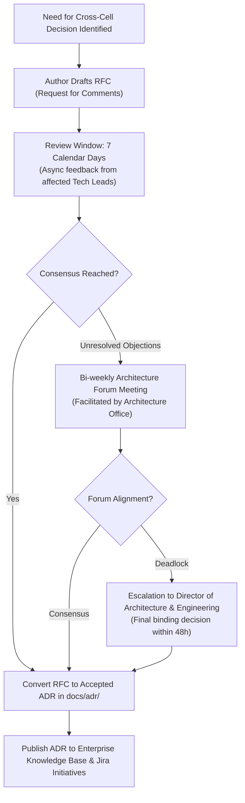
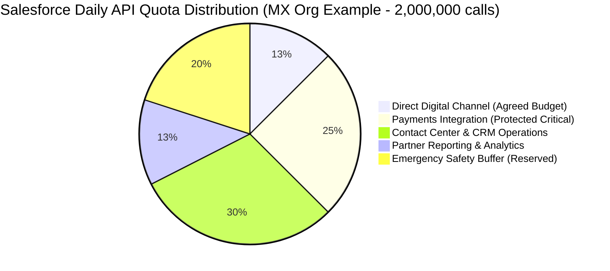

# Cross-Cell Interfaces, Dependencies, and Architecture Governance

## 1. Dependency Map for BR-01 (Home Essentials)

To deliver Home Essentials across Mexico, Colombia, and Chile, the **Direct Digital Channel** depends on several cross-functional cells and platform teams. The table below formalizes these interfaces, contracts, SLOs, and consumption agreements:

| Cell / Team | Provides | Interface Type & Technology | Contract Artifact | Target SLO / SLA | Agreements Needed |
|---|---|---|---|---|---|
| **Salesforce Platform Team** | • Rating calculation & policy core • System APIs (`sf-policy-sapi-{ctry}`) • Rating tables sync | REST / HTTPS via MuleSoft API Manager | OpenAPI 3.0 Contract (`sf-policy-sapi.yaml`) | • Availability: 97% monthly • Latency: p95 < 1.1s (rating), < 4.0s (issuance) • Max Rate: 40 req/s | • Daily API call budget per country org (MX: 250k, CO: 300k, CL: 150k). • Daily publication of 6 rating tables at 05:00 UTC with version tags. • Loan of 1 MuleSoft developer for 6 weeks in Q1 2027 (request before 15 Dec 2026). |
| **Payments Integration Cell** | • Payment tokenization & collection • Webhook / Event notification on charge success/failure | REST API (`payments-xapi`) & Asynchronous Event (Azure Service Bus: `payment.processed.v1`) | AsyncAPI 2.0 / OpenAPI 3.0 | • Availability: 99.9% • Latency: p95 < 2.0s | • Coordinated backpressure agreement: Payments pauses consumers at 85% org quota; Channel agrees to throttle batch issuance if org hits 80%. • Mutual idempotent payment tokens (`Idempotency-Key`). |
| **Communications Cell** | • Policy schedule & welcome pack delivery via Email & WhatsApp • SMS verification codes | Process API (`communications-papi`) & Message Queue (`comms.notification.requested.v1`) | OpenAPI 3.0 / CloudEvents | • Delivery SLA: Document sent to customer in < 3 minutes of issuance (BR-01 requirement) | • Shared transactional templates for Home Essentials in Spanish (MX, CO, CL variations). • Zero PII retention in Communications SaaS logs. |
| **Identity & Access Team** | • OIDC Token issuance, customer authentication, and workforce MFA • JWKS endpoints | HTTPS / OIDC (JWT) | OpenID Connect Core 1.0 Specs | • Availability: 99.95% • Key refresh latency < 200ms | • 14-day advance notice for JWKS token signing key rotations. • Standardized claims schema: `sub`, `ctry`, `sf_account_id` (customers), and `countries`, `roles` (workforce). |
| **Claims Cell** | • Existing claims lookup for customer self-service home portal | Experience API (`claims-xapi`) | OpenAPI 3.0 | • Availability: 99.5% • Latency: p95 < 1.5s | • Read-only access to customer policy claims status. |
| **Data & Analytics Cell** | • Real-time funnel metrics, conversion tracking, quote abandonment | Event Stream (Azure Event Hubs: `quote.funnel.events.v1`) | Avro / Schema Registry | • Ingestion availability: 99.9% | • Strict pseudonymization: Customer IDs hashed with SHA-256; zero plaintext PII emitted into analytics streams. |
| **Security & Privacy Office** | • Architecture review & threat modeling • Penetration testing approval | Governance Review | Security Architecture Sign-off | • Review SLA: 5 business days | • Exception waiver retired for direct Salesforce calls; formal approval of Key Vault Managed Identity model. |

---

## 2. Cross-Cell Technical Decision Governance

When technical decisions affect multiple cells (e.g., event schemas, API gateway policies, identity claims, shared data models), decisions must not be made in silos. We establish a structured, transparent decision process:

### 2.1 Governance Principles:
1. **RFC & ADR Process:** Any architectural change touching shared infrastructure, APIs, or data models starts as a lightweight RFC (*Request for Comments*) document in Markdown. Once agreed upon, it is committed to Git as an **Architecture Decision Record (ADR)** using the standardized template.
2. **Bi-Weekly Architecture Forum:** The Technical Leads of all cells meet every two weeks, facilitated by the Architecture Office. The forum reviews open RFCs, cross-cell dependencies, and capacity requests (e.g., MuleSoft platform developer sharing).
3. **Escalation Path:** If two cells reach an impasse (e.g., quota allocation conflicts between Payments and Digital Channel), the issue is escalated to the Director of Digital Channels and the Director of Architecture for a binding decision within 48 hours based on business value and system reliability.

---

## 3. Salesforce API Consumption Governance & Quota Budgeting

Salesforce API limits are a finite, shared company resource. In incident **INC-0907**, unmonitored consumption caused Payments to pause and degraded the entire Mexican operation. We establish a proactive governance framework to plan, measure, and enforce consumption.

### 3.1 Allocation Model & Safety Buffers

For each 24-hour rolling window, org-wide quotas are allocated across cells with hard safety reserves:

| Org | Total 24h Allocation | Channel Budget | Payments Budget | CRM / Contact Center | Buffer (Unallocated) |
|---|---|---|---|---|---|
| **MX** | 2,000,000 | **250,000 (12.5%)** | 500,000 (25.0%) | 600,000 (30.0%) | 650,000 (32.5%) |
| **CO** | 2,400,000 | **300,000 (12.5%)** | 600,000 (25.0%) | 700,000 (29.2%) | 800,000 (33.3%) |
| **CL** | 1,600,000 | **150,000 (9.4%)** | 400,000 (25.0%) | 500,000 (31.2%) | 550,000 (34.4%) |

### 3.2 Real-Time Monitoring and Multi-Tier Alert Thresholds

We implement automated telemetry tracking in Azure Monitor, collecting metrics directly from MuleSoft API Manager and Salesforce Organization Limits REST API (`/services/data/v61.0/limits`):

| Threshold | Trigger Condition | Automated Action | Responsible Team |
|---|---|---|---|
| **Tier 1 (Normal Warning)** | Channel consumes **70%** of its daily budget (175k in MX). | Warning alert emitted to `#channel-ops` Slack. On-call reviews traffic patterns. | Direct Digital Channel On-call |
| **Tier 2 (High Consumption)** | Org-wide usage reaches **75%**, OR Channel reaches **85%** of budget. | • Rate-limiter on non-critical endpoints activated (e.g. throttling quote drafts). • PagerDuty alert to Technical Leads of Channel and Salesforce. | Channel Tech Lead + Salesforce Platform Lead |
| **Tier 3 (Critical Protection)** | Org-wide usage reaches **80%** (5% before Payments pause). | • Automatic freeze of all non-essential batch background jobs. • Channel quoting shifts 100% to local cached calculations. • Issuance backlog is throttled to 5 req/s. | Incident Commander / Tech Leads |
| **Tier 4 (Emergency Breach)** | Org-wide usage hits **85%**. | • Payments pauses consumers (per their runbook). • Immediate emergency request to Salesforce Support for temporary 500k call increase. | Enterprise Incident Commander |

### 3.3 Monthly Capacity Planning Reviews
- On the first Tuesday of every month, the Salesforce Platform Team and all cell Technical Leads hold a **Quota Review Board**.
- Historical consumption curves, upcoming commercial campaigns (e.g., Hot Sale, Cyber Monday, month-end peaks), and new product launches (such as Home Essentials rollout dates) are evaluated to reallocate or temporarily augment Salesforce API buckets in advance.
