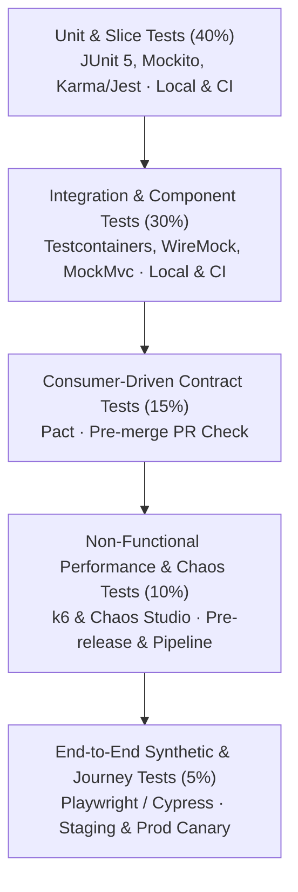
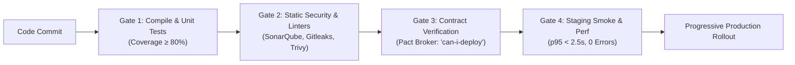

# Engineering Standards, Quality Gates, and Delivery Strategy

## 1. Test Strategy for the Direct Digital Channel

To achieve high delivery velocity while ensuring system resilience (**C1**) and sub-2.5s p95 latency (**C2**), the cell enforces an automated Testing Pyramid with explicit ownership:

### 1.1 Test Levels, Scopes, and Ownership

| Level | Scope & Layer | Tools / Frameworks | Who Writes & Runs | Pipeline Stage |
|---|---|---|---|---|
| **Unit Tests** | Individual functions, domain services, calculators, and UI pipes. | JUnit 5, Mockito, AssertJ (Java); Karma/Jasmine (Angular); MUnit (MuleSoft). | Developers (Internal & Nimbus). Runs locally and on every commit. | Pre-commit & CI Build stage. |
| **Component / Integration Tests** | Spring `@SpringBootTest`, slice controllers, repository queries with real databases. | Testcontainers (PostgreSQL, Redis), WireMock (downstream HTTP mocks). | Developers & QA Engineer. | CI Build stage (pull request). |
| **Consumer-Driven Contract Tests** | Interface boundaries: Frontend <-> BFF, and BFF <-> `quote-xapi` / Process APIs. | **Pact** (Pact JVM, Pact JS, Pact Broker). | Consumer authors consumer test; Provider verifies contract in pipeline. | CI Pull Request Gate (Blocks merge if contract broken). |
| **Performance & Load Tests (C2)** | End-to-end quote and issuance workflows under peak volume (3× MX, 2× CO/CL). | **k6** or Gatling running against isolated staging environments. | QA Engineer & Tech Lead. | Nightly build & pre-release staging gate. |
| **Chaos & Resilience Tests (C1)** | Simulates downstream timeouts (e.g. 30s Salesforce delays), connection drops, and tenant starvation. | Azure Chaos Studio, Toxiproxy, WireMock Fault Injection. | Tech Lead & Reliability / DevOps. | Bi-weekly scheduled chaos game-day in staging. |
| **End-to-End Journey Tests** | Happy paths and edge cases for quote-and-buy in each country. | Playwright running headless cross-browser scripts. | QA Engineer. | Post-deployment smoke & synthetic monitoring. |

---

## 2. Automated Quality Gates

Quality gates are enforced automatically in the Azure DevOps CI/CD pipeline. Bypassing gates requires Director-level sign-off.

| Gate Stage | Check / Tool | Mandatory Threshold | Action on Failure |
|---|---|---|---|
| **PR Build** | Unit & Integration Test Coverage (JaCoCo / Istanbul) | **≥ 80% line coverage** on new code; ≥ 75% overall repository coverage. | Pull request blocked automatically from merging. |
| **Static Analysis** | SonarQube Quality Gate | **Quality Gate: PASSED** • 0 Blocker or Critical Bugs • 0 Vulnerabilities • Duplicated code < 3% | PR blocked from merge. |
| **Secret Detection** | **Gitleaks** / GitHub Advanced Security | **0 plaintext secrets, API keys, or certificates detected.** | Commit rejected immediately at pre-receive hook / CI failure. |
| **Dependency Scanning** | Snyk / OWASP Dependency-Check (SCA) | **0 High or Critical CVEs** in third-party libraries. | Pipeline fails; pull request blocked. |
| **Contract Gate** | Pact Broker (`can-i-deploy`) | **All consumer contracts verified** by target provider version. | Deployment artifact packaging halted. |
| **Performance Gate** | k6 Load Test in Staging | **p95 Latency < 2,500 ms** at 150% peak load; 0 HTTP 5xx responses. | Automatic promotion to production aborted. |

---

## 3. Code Review, Branching, and AI-Assisted Code Policy

### 3.1 Branching Model
- **Trunk-Based Development with Short-Lived Feature Branches:**
  - Branches name convention: `feature/<jira-id>-<short-description>`, `fix/<jira-id>-<description>`.
  - Maximum branch lifespan: **48 hours**. Long-lived branches (> 1 sprint) are prohibited.
  - Release artifacts are built once from `main` and promoted across environments (Build Once, Deploy Many).

### 3.2 Code Review Standards
- Every pull request requires at least **two approvals**: one peer developer and the Technical Lead (or designated senior delegate).
- PR description must include: context, Jira ticket reference, test evidence screenshot/log, and checklist verification.
- **AI-Assisted Code Policy:**
  - If any code or tests were generated with AI assistants (GitHub Copilot, Gemini Code Assist, etc.), it must be declared in the PR description (*"AI-Assisted: Yes (Tool: Gemini Code Assist / Scope: Unit Test Scaffolding)"*).
  - The human author remains 100% accountable for correctness, security, and performance. AI-generated code without comprehensive human validation and test assertions is rejected.

---

## 4. Vendor Governance: Nimbus Digital Contract Renewal (31 January 2027)

To eliminate vendor delivery silos and resolve issues identified in **C8**, the contract renewal on 31 January 2027 must incorporate the following legally binding engineering clauses:

| Area | Contractual Requirement for Nimbus Digital | Verification & Enforcement Mechanism |
|---|---|---|
| **Unified CI/CD Tooling** | All Mexican source code (`channel-bff`, `web-quote-ui`, MuleSoft APIs) must be authored and merged in Meridian's Azure DevOps repositories. Independent Nimbus CI deployments are terminated. | Revocation of legacy shared deployment credentials on 31 January 2027. Deployments occur exclusively via Meridian Azure Pipelines. |
| **Quality & Coverage Standards** | Nimbus must adhere to identical quality gates: ≥ 80% test coverage, 0 SonarQube blocker/critical bugs, and 0 secret leaks. | Automated gating in Azure Pipelines; PRs cannot merge without Meridian Tech Lead approval. |
| **Definition of Done (DoD)** | A unified Definition of Done across internal and vendor teams: working code, passing unit and contract tests, documentation updated, OpenAPI validated, and zero open SonarQube issues. | Bi-weekly sprint reviews and automated pipeline gate reports. |
| **Security Auditing** | Mandatory static and container vulnerability scans before any artifact promotion. Quarterly third-party penetration testing compliance. | Automated Trivy / Snyk scans integrated into CI; monthly security office audit. |
| **Service Level Agreement** | Critical production defects introduced by vendor code must achieve median Time to Restore Service (TTRS) < 2 hours. | Financial penalty clauses tied to SLA breaches and change failure rates > 15%. |

---

## 5. DORA Delivery Metrics: Baseline and Q2 2027 Targets

Based on the 2026-Q3 baseline recorded in [`context/DELIVERY_METRICS.md`](file:///context/DELIVERY_METRICS.md), we establish clear, realistic DORA targets for the end of Q2 2027:

| DORA Metric | Q3 2026 Baseline (CO / CL / MX) | Target (End of Q2 2027) | Strategic Reasoning & Enablers |
|---|:---:|:---:|---|
| **Deployment Frequency** | CO: Weekly CL: Bi-weekly MX: Monthly | **Daily to Multiple times per week** across all countries | Unified codebase, automated CI/CD pipeline template, automated testing gates, and canary releases remove release ceremony. |
| **Lead Time for Changes** | CO: 6 days CL: 11 days MX: 24 days | **< 3 calendar days** (commit to production) | Eliminates manual staging reviews and vendor handover delays; PRs merge to `main` and deploy via automated stages. |
| **Change Failure Rate (CFR)** | CO: 12% CL: 18% MX: 31% | **< 5%** across all countries | Automated contract testing (Pact), mandatory 80% test coverage, and automated staging performance checks prevent broken releases. |
| **Time to Restore Service (TTRS)** | CO: 3 hours CL: 5 hours MX: 9 hours | **< 30 minutes** (median) | Instant automated rollback in Azure Container Apps, real-time multi-burn-rate alerts, feature flags, and tenant bulkheads. |

---

## 6. Golden Path: New Service Starter Template

To enable teams to start compliant from Day 1, the cell provides a cookiecutter / starter archetype repository (`template-service-starter`):

### 6.1 Starter Archetype Contents:
1. **Pre-configured Framework:** Spring Boot 3.3+ (Java 21) or MuleSoft 4.5+ template with pre-tuned HikariCP connection pools and WebClient settings.
2. **Built-in Resilience & Telemetry:**
   - Resilience4j circuit breakers and bulkheads pre-configured with the standard 2.5s timeouts.
   - Azure Application Insights telemetry initializer with PII auto-masking filters.
   - Health and Readiness probes (`/actuator/health/readiness`, `/liveness`).
3. **Security Defaults:**
   - Spring Security OIDC JWT validator parsing `sub`, `ctry`, and `sf_account_id`.
   - Azure Key Vault Managed Identity secret injection configuration.
4. **Testing Harness:**
   - Pre-wired Testcontainers for PostgreSQL and Redis.
   - Pact consumer/provider verification template.
5. **CI/CD Pipeline:** Reference `azure-pipelines.yml` extending the shared pipeline template.
