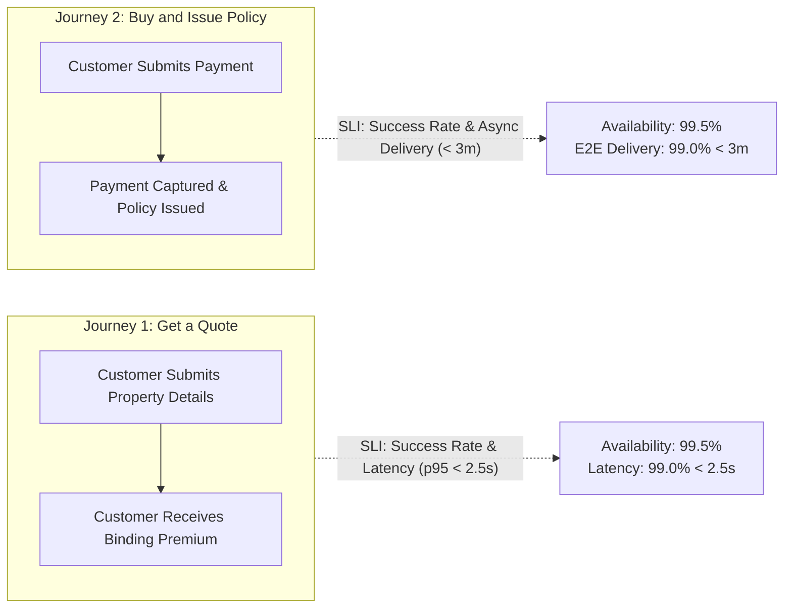
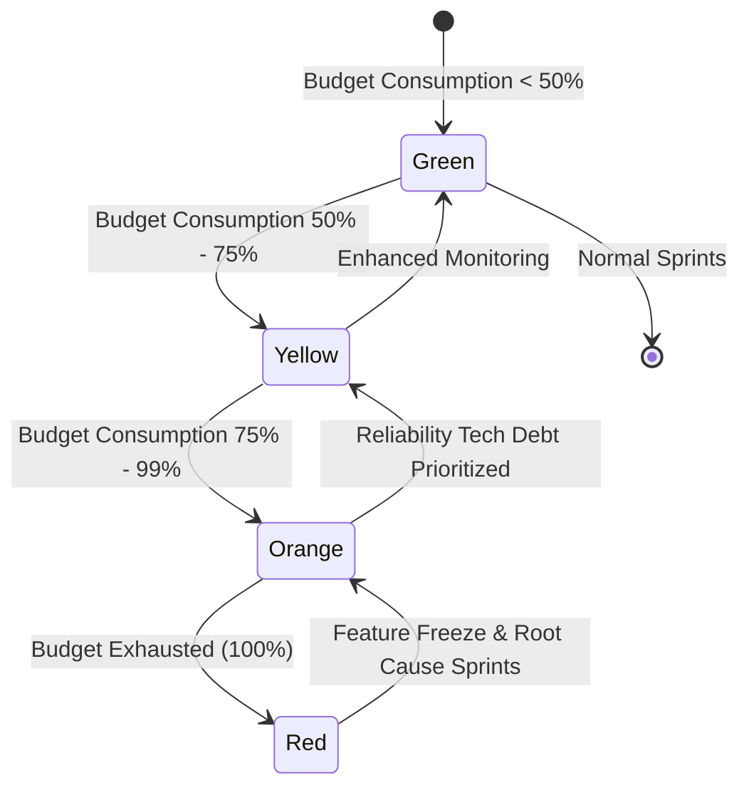
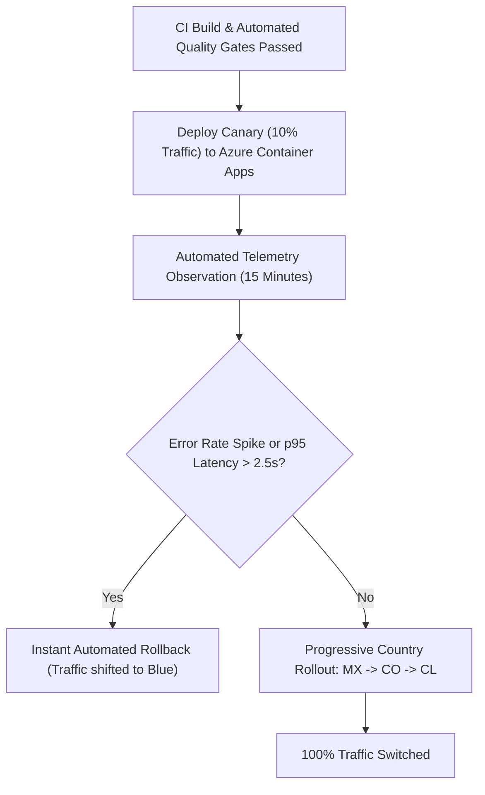

# Service Level Objectives (SLOs) and Error Budget Policy

## 1. Critical User Journeys and Service Level Indicators (SLIs)

The Direct Digital Channel defines Service Level Indicators (SLIs) and Service Level Objectives (SLOs) around customer-centric user journeys rather than raw server metrics (CPU/RAM). In accordance with **C1** and **C2**, these are measured and enforced independently per country (**Mexico, Colombia, Chile**).

---

### Journey 1: Get a Quote (Home Essentials & Auto)

*User expectation:* The customer fills the questionnaire and receives an accurate premium in under 2.5 seconds without encountering errors.

| Metric | Target (SLO - Rolling 30 Days) | SLI Specification & Measurement Logic | Measurement Window & Source |
|---|:---:|---|---|
| **Availability (Success Rate)** | **≥ 99.5%** per country | Proportion of valid quote requests (`POST /v1/quotes`) that return HTTP `201 Created` or valid business rejection (`422 Unprocessable Entity`).  $$\text{SLI} = \frac{\sum \text{Responses with HTTP } \{201, 422\}}{\sum \text{All Quote Requests (excluding client errors } 400, 401, 403)}$$ | Measured at `quote-xapi` API Gateway logs & Azure Application Insights. Evaluated over rolling 30 days. |
| **Latency (p95)** | **≥ 99.0% < 2.5 s** per country (C2) | Proportion of successful quote calculations completed and returned to the client within 2,500 milliseconds (including peak periods).  $$\text{SLI} = \frac{\sum \text{Successful Quotes with Latency } \le 2,500\text{ ms}}{\sum \text{All Successful Quotes}}$$ | Measured from time request is received at API Gateway until the final byte is returned to client. |

---

### Journey 2: Buy and Issue Policy

*User expectation:* The customer completes payment authorization and receives policy confirmation on screen within 4 seconds, and policy documentation via email/WhatsApp in under 3 minutes (BR-01).

| Metric | Target (SLO - Rolling 30 Days) | SLI Specification & Measurement Logic | Measurement Window & Source |
|---|:---:|---|---|
| **Purchase Checkout Availability** | **≥ 99.5%** per country | Proportion of policy binding requests (`POST /v1/policies/bind`) that return HTTP `200/201/202`.  $$\text{SLI} = \frac{\sum \text{Responses with HTTP } \{200, 201, 202\}}{\sum \text{Total Binding Requests}}$$ | Measured at Channel BFF checkout endpoints. |
| **End-to-End Policy Delivery Latency** | **≥ 99.0% < 180 s** per country | Proportion of paid policies where the policy record is written to Salesforce Core AND the welcome document is dispatched by the Communications Cell in under 3 minutes (180 s). | Correlated via `correlationId` between Payment Event timestamp and Communications delivery receipt. |

---

## 2. Error Budget Policy

Each country operates with an independent monthly error budget. For a **99.5% availability SLO**, the monthly error budget allows a maximum of **0.5% unacceptable requests** (or ≈ 3.6 hours of downtime per 30-day month).

| Budget State | Error Budget Consumed | Operational and Engineering Actions |
|---|:---:|---|
| **Green (Healthy)** | **< 50%** | • Normal product feature delivery continues. • Standard automated CI/CD deployments enabled for internal and Nimbus teams. |
| **Yellow (Caution)** | **50% – 75%** | • Postmortem review required for any incident burning > 10% budget in 24 hours. • Increase synthetic testing frequency from 5 min to 1 min. |
| **Orange (At Risk)** | **75% – 99%** | • Non-critical releases frozen (only bug fixes, security patches, and reliability improvements). • Next sprint must allocate at least **50% of developer capacity** to reliability and performance tasks. |
| **Red (Exhausted)** | **100% (Budget Depleted)** | • **Complete Feature Freeze:** All new feature deployments halted for that country (including BR-01 pilot increments). • **100% Capacity Redirection:** Both internal developers and Nimbus Digital work exclusively on architectural remediation, performance tuning, and technical debt until error budget resets. • Mandatory executive report to Director of Digital Channels explaining root cause and preventative controls. |

---

## 3. Alerting Strategy: Multi-Window Multi-Burn-Rate Alerts

To eliminate alert fatigue and ensure on-call engineers are paged only for actual, actionable customer impact (addressing TD-07 where alerts only fired on CPU/RAM), we implement **Google SRE Multi-Window Multi-Burn-Rate alerting**:

| Alert Name | Burn Rate | % Budget Consumed | Time to Exhaust Budget | Alert Window (Short / Long) | Severity & Action |
|---|:---:|:---:|:---:|:---:|---|
| **Critical Budget Burn (SEV1/SEV2)** | **14.4×** | 2% in 1 hour | 2 days | 2 min / 1 hour | **Page On-Call Immediately (PagerDuty).** Severe incident in progress; urgent mitigation required. |
| **Elevated Budget Burn (SEV2)** | **6×** | 5% in 6 hours | 5 days | 15 min / 6 hours | **Page On-Call Immediately.** Persistent degradation draining substantial budget. |
| **Moderate Budget Burn (SEV3)** | **1×** | 10% in 3 days | 30 days | 1 hour / 3 days | **Ticket / Slack Notification.** Non-urgent warning to `#channel-ops`; addressed during next business day. |
| **Salesforce Quota Burn Alert** | N/A | Org quota > 75% | Few hours | Instant rolling check | **Page Tech Lead & On-Call.** Prevents 85% Payments pause threshold from being breached. |

---

## 4. Safe Deployment and Rollback Strategy

Deployment safety applies to both internal components and vendor code delivered by Nimbus Digital (C8):

### 4.1 Deployment Guidelines:
1. **Canary & Blue/Green Deployments:** All Container App services deploy a new revision receiving 10% of country traffic for 15 minutes.
2. **Automated Rollback Triggers:** If during the 15-minute canary window:
   - 5xx error rate exceeds 0.5%, OR
   - Latency p95 exceeds 2,500 ms, OR
   - Unhandled exceptions increase by > 20%,
   the Azure Container App ingress automatically shifts 100% traffic back to the prior stable revision without human intervention.
3. **Staggered Multi-Country Progression:** Releases never deploy simultaneously across countries. A new release is deployed first to Mexico (canary -> full), observed for 24 hours in production, and only then promoted to Colombia and Chile.
4. **Feature Flags:** Every new business capability (such as Home Essentials quoting) is wrapped in a launchdarkly or Azure App Configuration feature flag, allowing instant deactivation within 5 seconds without triggering a pipeline rollback.
