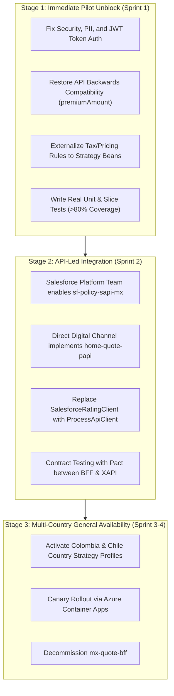

# Pull Request Review: PR-388 — MX: Home Essentials Quick Quote (BR-01 Pilot)

| Item | Value |
|---|---|
| **Repository** | `channel-bff` |
| **Branch** | `feature/mx-home-quick-quote` → `main` |
| **Author** | Diego R. (Nimbus Digital) |
| **Reviewer** | Technical Lead (Direct Digital Channel) |
| **Scope** | 11 files, +283 / −3 lines |

---

## 1. Findings Table

The findings below are ordered strictly by severity: **Critical, High, Medium, Low**.

| # | File | Line (New) | Severity | Category | Issue Description | Requested Change |
|---|---|:---:|:---:|:---:|---|---|
| 1 | `src/main/resources/application-mx.yml` | 8 | **Critical** | Security (C5) | **Hardcoded Plaintext Client Secret:** The Salesforce OAuth client secret (`9F2C7A41D08E6B35C1F4A7E2D9B0C68A`) is committed in plain text in the repository. | Remove credential immediately. Invalidate and rotate the secret in Salesforce MX Org. Inject secrets via Azure Key Vault using `@ConfigurationProperties` and Azure Managed Identity (`DefaultAzureCredential`). |
| 2 | `src/main/java/com/meridian/channel/home/HomeQuoteService.java` | 24 | **Critical** | Privacy & Compliance (C5) | **Plaintext PII Logging:** The logger logs customer full name, national ID (`RFC/CURP`), and personal email in cleartext: `log.info("... requested by {} (nationalId={}, email={}) ...")`. Violates personal data protection laws. | Strip all personal data from application log statements. Log only the pseudonymized `customerId` (OIDC `sub`) and `quoteId`. Configure Logback masking filters for PII. |
| 3 | `src/main/java/com/meridian/channel/home/HomeQuoteController.java` | 27–28 | **Critical** | Security & Auth (C5) | **Untrusted Identity & Country Headers:** The endpoint extracts `country` and `customerId` from unverified request headers (`X-Country`, `X-Customer-Id`). Any caller can spoof any user ID or bypass country restrictions (IDOR vulnerability). | Remove reliance on untrusted client headers. Extract customer identity (`sub`), bound Salesforce Account (`sf_account_id`), and country (`ctry`) directly from the validated Spring Security `JwtAuthenticationToken`. |
| 4 | `api/channel-quote-api.yaml` `src/main/java/com/meridian/channel/quote/QuoteResponse.java` | 45 (yaml) 8 (java) | **Critical** | API Governance (C3) | **Breaking Contract Change on Shared API:** Renamed `premiumAmount` to `totalPremium` in the shared `QuoteResponse` schema and Java record. This breaks existing Colombian and Chilean frontend consumers in production. | Retain `premiumAmount` as mandatory for backward compatibility. Add `totalPremium` as a new field (or an alias), deprecating `premiumAmount` gracefully over a scheduled release cycle. |
| 5 | `src/main/java/com/meridian/channel/integration/SalesforceRatingClient.java` | 18–47 | **High** | Architecture (C4) | **Direct Salesforce Invocation:** BFF directly invokes Mexican Salesforce REST endpoints (`/services/data/...` and `/services/apexrest/...`), bypassing MuleSoft API Manager and re-introducing technical debt TD-02 into `channel-bff`. | Remove direct Salesforce HTTP client. Route Home Essentials rating requests through the MuleSoft API-Led path (`quote-xapi` -> `home-quote-papi` -> `sf-policy-sapi-mx`). |
| 6 | `src/main/java/com/meridian/channel/integration/SalesforceRatingClient.java` | 69 | **High** | Performance & Resilience (C2, C6) | **Token Request on Every Call (No Caching):** `authHeaders()` requests a fresh OAuth token from Salesforce on every single invocation (`postForObject(tokenUrl, ...)`). Causes extreme latency and risks hitting Salesforce token rate limits. | If external OAuth is needed, cache the Bearer token in memory with an expiration buffer (e.g. refresh at 90% of `expires_in`). Note: This becomes obsolete once routed through MuleSoft. |
| 7 | `src/main/java/com/meridian/channel/home/HomeQuoteService.java` | 31–40 | **High** | Domain Design (C3) | **Hardcoded Business Logic & Float Math:** Mexican tax calculations (`16%`), coastal surcharge rules (`postalCode.startsWith("77")`), and Colombian taxes (`19%`) are hardcoded in the service. Uses `double` instead of `BigDecimal` for currency. | Pricing and tax rules belong in Salesforce Core / Rating tables or externalized strategy beans (`TaxStrategy`). Use `BigDecimal` with explicit rounding modes (`RoundingMode.HALF_UP`) for financial currency amounts. |
| 8 | `src/test/java/com/meridian/channel/home/HomeQuoteServiceTest.java` | 15, 30 | **High** | Quality Standards | **Mocking the Class Under Test:** The test class declares `@Mock HomeQuoteService homeQuoteService` and stubs its own method. It tests zero implementation logic. The second test (`quickQuoteForColombia`) only asserts `assertNotNull(homeQuoteService)`. | Refactor test: Mock dependencies (`SalesforceClient` / `ProcessApiClient`), instantiate the real `HomeQuoteService`, and assert actual calculations, tax logic, and exception handling. |
| 9 | `src/main/resources/application.yml` | 9 | **Medium** | Configuration & Rollout | **Feature Flag Enabled Globally:** `meridian.features.home-quick-quote.enabled` is set to `true` in base `application.yml`, activating the pilot in all environments and countries. | Set feature flag to `false` by default in base `application.yml`. Enable it selectively only in `application-mx.yml` (and UAT profiles). |
| 10 | `src/main/java/com/meridian/channel/integration/SalesforceRatingClient.java` | 21 | **Medium** | Resilience (C1) | **Unconfigured HTTP Client:** Uses bare `new RestTemplate()` without connect/read timeouts, connection pooling, or Resilience4j circuit breakers. | Configure managed `RestClient` / `WebClient` with explicit 2.5s read timeouts, connection pool sizing, and circuit breakers. |

---

## 2. Verdict

### **REQUEST CHANGES**

**Prerequisites for Merge:**
1. **Security & Secrets Remediation:** Invalidate the committed Salesforce client secret in the MX Salesforce Org immediately. Remove `application-mx.yml` secret credentials from git history.
2. **PII Scrubbing:** Eliminate customer PII from logging.
3. **Identity Token Integration:** Refactor controller to consume identity claims from OIDC JWT.
4. **API Backwards Compatibility:** Restore `premiumAmount` in `QuoteResponse` to protect Colombian and Chilean production traffic.
5. **Architectural Alignment:** Remove direct Salesforce REST client and wire through the API-Led integration layer.
6. **Legitimate Unit Tests:** Provide comprehensive unit and slice tests asserting real business rules with ≥ 80% genuine branch coverage.

---

## 3. Refactoring Proposal: Target Alignment & Staged Roadmap

To support the Mexican pilot without violating Meridian's architecture or delaying delivery, we execute the refactoring in three structured stages:

### Staged Vendor Instructions:
- **Sprint 1 (Immediate PR Fix):** Diego focuses on controller security (JWT extraction), PII removal, backward-compatible API schemas, and genuine unit tests. If the MuleSoft API is still 2 weeks away, a temporary mock client or controlled interface is acceptable *behind an approved 1-sprint ADR exception*.
- **Sprint 2 (Architecture Alignment):** Replace the temporary client with the official MuleSoft `home-quote-papi` client once delivered by the integration team.
- **Sprint 3 (Regional Pilot):** Promote the pilot to UAT with contract tests verified.

---

## 4. Mentoring Feedback to Author (Diego R., Nimbus Digital)

> **To:** Diego R.  
> **Subject:** Review & Next Steps for PR-388 (`feature/mx-home-quick-quote`)  
>
> Hi Diego,
>
> Thank you for opening PR-388 and for your great work driving the Home Essentials pilot for Mexico. Bringing Mexican capabilities into `channel-bff` is a crucial milestone for our regional vision, and I appreciate your speed in getting this pilot ready.
>
> I have requested changes on the PR. There are a few critical architectural, security, and stability items we need to address before merging to `main`:
>
> 1. **Credential & Data Protection (C5):** The Salesforce client secret in `application-mx.yml` was committed in plain text. Please notify the Salesforce team immediately to revoke and rotate this secret. Going forward, secrets are injected via Azure Key Vault using Managed Identities. Additionally, please remove customer PII (full name, national ID, email) from log statements; our logs must only record pseudonymized identifiers like `customerId`.
> 2. **Authentication & Identity:** In `HomeQuoteController`, please avoid trusting `X-Customer-Id` and `X-Country` headers directly. Instead, extract `sub`, `sf_account_id`, and `ctry` from the authenticated Spring Security `JwtAuthenticationToken`. This guarantees zero-trust security and prevents identity spoofing across tenants.
> 3. **API Contract Compatibility:** In `QuoteResponse`, renaming `premiumAmount` to `totalPremium` introduces a breaking change for existing Colombia and Chile frontend apps in production. Please retain `premiumAmount` and add `totalPremium` alongside it.
> 4. **API-Led Integration & Salesforce Core (C4, C6):** The `SalesforceRatingClient` bypasses our MuleSoft layer and calls Salesforce directly. As we experienced in incident INC-0907, direct calls risk exhausting the org’s 40 req/s limit. The integration team is prioritizing the Home Essentials Process API this sprint. In the interim, let’s decouple the rating call behind a clean `QuoteEngineClient` interface so we can plug in the MuleSoft client seamlessly.
> 5. **Unit Tests:** In `HomeQuoteServiceTest`, the service under test is mocked rather than instantiated. Let’s mock the downstream clients and write assertions against the real service logic.
>
> I know you are under tight delivery pressure for the pilot. Let's pair up tomorrow for 30 minutes to review the JWT helper and Key Vault setup so you can clear these blockers quickly.
>
> Thanks again for your hard work, Diego!
>
> Best regards,  
> **Technical Lead, Direct Digital Channel**
