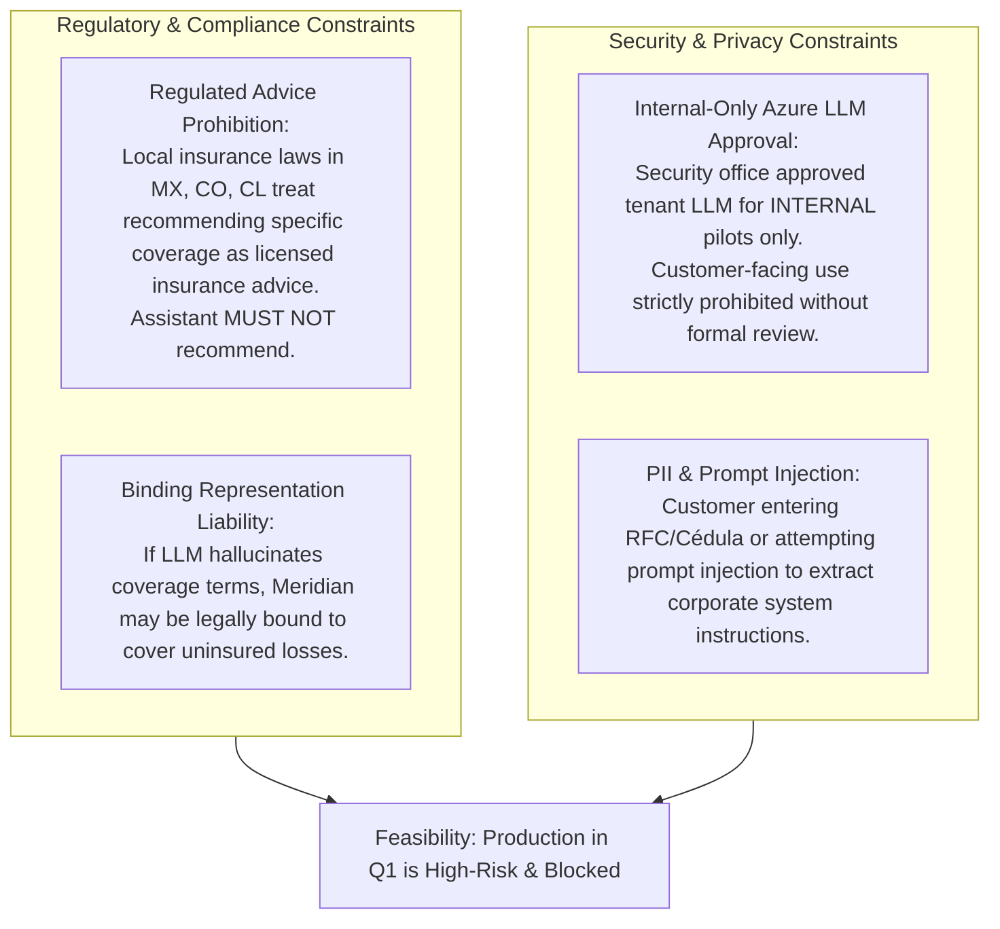
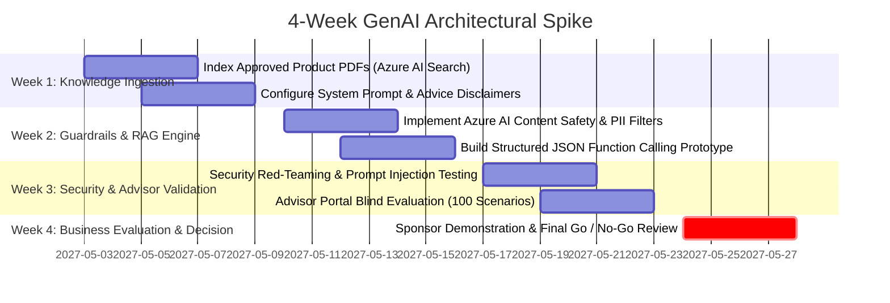
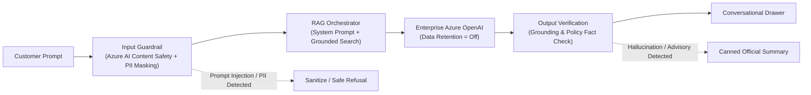

# Technical Feasibility Analysis — BR-02: GenAI Assistant in Quote Journey

## 1. Executive Answer to Sponsor

> **Sponsor's Ask:** *"I need a yes or a no, and a date."*  
> **Technical Lead's Recommendation:** **NO for Q1 2027 Production Launch; YES for a 4-Week Exploratory Spike in May 2027 (Q2), targeting potential internal/controlled pilot in Q3 2027.**

---

## 2. Business Value, Technical Effort, and Risk Profile

### 2.1 Quantified Business Value (Evidence-Based)
From the evidence provided by the Chief Commercial Officer (`context/BUSINESS_REQUESTS.md`):
- **Abandonment Problem:** Quote abandonment rates are alarmingly high: **68% in Mexico, 61% in Colombia, and 64% in Chile**.
- **Customer Pain Point:** In an exit survey of 2,300 customers, **41% of abandoning users stated they did not understand the insurance coverages**.
- **Contact Center Operational Drain:** Coverage inquiries generate **≈ 18,000 monthly calls** across the three countries (MX: 8,100; CO: 6,900; CL: 3,000). At an average cost of **USD 4.10 per call**, Meridian spends over **USD 73,800 per month (≈ USD 885,000 annually)** answering basic coverage questions.
- **Potential Upside:** Deflecting even 20% of these calls and converting 5% of abandoned quotes into bound policies would generate massive operational savings and revenue.

### 2.2 Missing Information and Blind Spots
1. **Model Latency Impact on User Flow:** LLM token streaming takes 1.5 s – 4.0 s. If integrated synchronously into the quote journey, it risks violating **C2 (< 2.5s p95)** unless designed as an asynchronous floating conversational drawer.
2. **Token Economics & Cost Profile (C9):** No token pricing or inference cost estimates exist for Azure OpenAI in Meridian's tenant under peak loads.
3. **Pre-fill Accuracy:** We lack empirical data on how reliably an LLM can extract structured quote fields (e.g., square meters, postal code) from unstructured natural Spanish text across Mexican, Colombian, and Chilean regional idioms without hallucination.

### 2.3 Critical Regulatory & Security Risks

---

## 3. Options Considered

### Option 1 — Deliver Customer-Facing GenAI in Q1 2027 (MX Pilot)
- Attempt to rush an Azure OpenAI RAG feature into the Mexican quote journey by March 2027.
- **Assessment:** **REJECTED.** Direct collision with BR-01 (Home Essentials launch on April 30); violates Security Office mandate (internal-only approval); high risk of legal penalties for giving unauthorized financial advice.

### Option 2 — Reject GenAI Completely and Rely on Static FAQ Tooltips
- Replace the AI concept with enhanced UI tooltips, glossary modal dialogs, and video explainers.
- **Assessment:** **REJECTED.** While safe, it ignores the 41% customer comprehension gap and fails to leverage Meridian's digital differentiator.

### Option 3 — Time-Boxed Spike in Q2 2027 with Strict Guardrails (Recommended)
- Conduct a disciplined 4-week architectural spike in May 2027 (Sprint 9–10) using 1 backend engineer and 1 frontend engineer.
- Prototype a RAG architecture (*Retrieval-Augmented Generation*) restricted strictly to approved PDF product sheets.
- **Assessment:** **ACCEPTED.** Protects BR-01 delivery while establishing safe, compliant AI foundations.

---

## 4. Time-Boxed Spike Plan (May 2027 / Q2 Sprints 9–10)

### 4.1 Scope of the Spike
1. **Curated Knowledge Base:** Ingest the official Spanish PDF policy wordings and product sheets for Home Essentials and Auto into Azure AI Search using hybrid semantic vector search.
2. **Intent Classification & Guardrails:**
   - Classify user queries: `INFORMATIONAL_COVERAGE`, `PREFILL_QUOTE`, or `ADVISORY_REQUEST`.
   - If the user asks *"Which policy should I buy?"*, trigger an automated hard-coded refusal: *"I am an automated assistant and cannot provide insurance advice. Here is an explanation of the differences between Plan A and Plan B..."*
3. **Structured Form Pre-Fill:** Use OpenAI Function Calling to extract validated JSON (`postalCode`, `squareMeters`, `includesContents`) without free-form hallucination.

### 4.2 Measurable Go / No-Go Criteria

At the end of the 4-week spike (28 May 2027), the feature proceeds to a customer pilot **ONLY if all five criteria are satisfied**:

| Criteria | Metric / Threshold | Pass / Fail Condition |
|---|---|---|
| **1. Zero Regulated Advice** | 100% compliance across 50 adversarial legal test prompts designed by Meridian Compliance. | **Pass:** 0 instances of recommending a specific plan or coverage. |
| **2. Factual Grounding (Zero Hallucination)** | Grounding score ≥ **95%** using RAGAS evaluation framework on approved product PDFs. | **Pass:** Zero fabricated coverages, deductibles, or limits. |
| **3. Latency & Responsiveness** | Time to First Token (TTFT) < **1.2 s**; complete response < **3.0 s**. | **Pass:** Conversational UI renders smoothly without freezing the quote form. |
| **4. Security Office Sign-Off** | Formal approval from Meridian Security Office for public customer-facing tenant access. | **Pass:** Documented security architecture approval. |
| **5. Commercial Feasibility** | Cost per completed interaction < **USD 0.05** (vs USD 4.10 for call center). | **Pass:** Proven positive ROI model. |

---

## 5. Mandatory Architecture Controls for Customer-Facing LLMs

If the spike passes, the following production architecture controls are strictly enforced:

1. **Strict Context Grounding (No Open-Ended Generation):** System prompt instructs the model: *"Answer strictly and exclusively using the retrieved document context below. If the answer is not in the text, reply: 'I do not have information on this specific question; please contact an advisor.' Never speculate or provide financial advice."*
2. **Human Handoff:** A persistent *"Chat with a Licensed Advisor"* button in the assistant window immediately transfers the conversation history to an advisor in the Advisor Portal.
3. **Zero Data Retention for Training:** Enterprise Azure OpenAI agreement confirms that zero customer inputs or conversations are retained or used to train public models.
